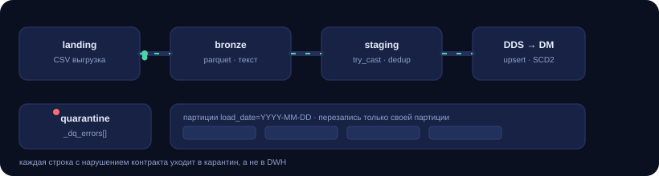

# 01 · Batch DWH: landing → bronze → DDS → DM

Классический ночной батч: выгрузка из OLTP попадает в landing, архивируется в
bronze как есть, типизируется и чистится в staging, затем мержится в DDS (3NF) и
собирается в витрину DM (звезда Кимбалла, SCD2). Всё под Airflow, между DDS и DM
стоит data-quality гейт.

<p align="center">
  
</p>

## Поток

```
landing/*.csv ──Spark──► bronze/parquet (текст, партиции load_date)
                              │
                              ├─ контракт нарушен ──► quarantine/ (с метками проверок)
                              ▼
                         stg.* (typed, dedup, JDBC truncate+insert)
                              │  update/insert по бизнес-ключу
                              ▼
                         dds.* (3NF, FK, CHECK)
                              │  SCD2 + звезда
                              ▼
                         dm.dim_* / dm.fact_sales  ──► dq gate ──► Prometheus
```

Файлы: `sql/01_schema.sql` → `sql/02_merge_orders.sql` → `sql/03_dm_schema.sql` →
`sql/04_build_dims.sql` → `sql/05_build_fact.sql`; Spark — `spark/jobs/ingest_bronze.py`
и `spark/jobs/load_staging.py`; оркестрация — `dags/orders_batch_dag.py`.

## Решения, которые здесь важны

**Bronze хранит текст.** Landing-зона — неизменяемая копия того, что отдал источник:
никаких кастов и фильтров на входе. Если завтра окажется, что `total_amount`
приходит с запятой вместо точки, партию переигрывают из bronze, а не просят
источник выгрузить заново.

**Типизация через `try_cast`.** Плохое значение превращается в `NULL` и ловится
правилом, а не роняет джобу на середине. Ошибка одного поля не останавливает
загрузку 800 заказов.

**Карантин вместо падения.** Строки с нарушением контракта пишутся в
`quarantine/<entity>/load_date=…` с массивом `_dq_errors`. Контракт источника
сломался — это видно как всплеск карантина в метриках, и данные не текут дальше.

**Идемпотентность на всех уровнях.**

| Слой | Механизм |
| --- | --- |
| bronze | `partitionOverwriteMode=dynamic` — перезапись только своей партиции |
| staging | `mode("overwrite")` + `truncate=true` — полная замена батча |
| DDS | `INSERT … ON CONFLICT (business_key) DO UPDATE` |
| DM (dims) | SCD2: закрытие текущей версии + открытие новой |
| DM (fact) | delete+insert по скользящему окну 3 дня |

Последний пункт — ответ на главный вопрос любого DWH: *что будет, если ночной
прогон упал на 80% и его перезапустят?* Ничего: состояние сойдётся к тому же.

**SCD2 защищён индексом.** `create unique index … where is_current` превращает
две актуальные версии клиента в ошибку загрузки, а не в двойной счёт в витрине.

**Oкно в факте, а не полный rebuild.** Заказы меняют статус и суммы после
создания, поэтому факт пересобирается за 3 дня: правки приезжают, история не
переписывается, стоимость загрузки ограничена.

## Запуск

```bash
cp .env.example .env
make up                 # postgres, minio, spark, airflow, kafka, clickhouse, prometheus, grafana
make landing            # синтетический landing-слой: 800 заказов + справочники
make dq                 # прогнать правила против DWH вручную
```

Дальше — UI Airflow (`localhost:8080`), DAG `orders_batch_dwh`, кнопка Trigger с
`logical date` = дата выгрузки. Пароль администратора Airflow печатается в
`docker compose logs airflow` (режим `standalone`, только для локального демо).

## Что проверяет DQ-гейт

Правила лежат в `03-dq-framework/dq/rules.yml`, применяются к этому пайплайну:
уникальность бизнес-ключей, обязательные поля, справочник статусов, отсутствие
сирот в DDS и в факте, объём и свежесть витрины, ровно одна актуальная версия
клиента в SCD2.
