# 02 · Streaming: Kafka → Spark Structured Streaming → DDS

Поток жизненного цикла заказа: `order_created → order_paid → order_cancelled |
order_refunded`. Kafka держит события, Spark Structured Streaming складывает их
в lake с exactly-once семантикой и чекпоинтами, компакция каждые 15 минут
переносит их в DDS и проецирует статус заказа.

<p align="center">
  
</p>

## Поток

```
producer ──► Kafka(order.events, key=order_id)
                    │  readStream, from_json, watermark 1h
                    ▼
        bronze/order_events/event_date=…   (parquet + checkpoint в lake)
                    │  compact_order_events (каждые 15 мин, replayable)
                    ├─ контракт/ссылка нарушены ──► quarantine
                    ▼
              stg.order_events ──merge──► dds.order_events
                                              │ проекция
                                              ▼
                                         dds.orders.status
```

## Решения, которые здесь важны

**Ключ партиционирования — `order_id`.** Вся жизнь одного заказа попадает в
одну партицию Kafka, поэтому порядок событий по заказу сохраняется без
глобальной сортировки.

**Партиция озера — `event_date`, а не дата загрузки.** Событие, приехавшее с
опозданием, обязано лечь в партицию дня, когда оно произошло, иначе окно
компакции его не увидит. Отсюда же `--lookback-days`.

**Дедупликация в два слоя.** Kafka даёт at-least-once, поэтому дубликаты — норма.
Слой 1: `dropDuplicates` по `event_id` с watermark. Слой 2: `primary key` в
`dds.order_events` + `ON CONFLICT DO NOTHING`. Один из слоёв рано или поздно
обойдут (ручной replay, миграция), второй останется.

**Валидация переходов живёт в DWH, а не в стриме.** Стрим видит только текущий
микро-батч, а история заказа — в DWH. Поэтому `07_merge_events.sql` считает
предыдущий статус через `LEFT JOIN LATERAL` по уже загруженным событиям и
помечает нелегальный переход `is_quarantined = true`, вместо того чтобы тихо
перезаписать правду.

**Один код — две семантики.** `--once` переключает триггер на `availableNow`:
тот же джоб превращается в ограниченный backfill после аварии, без отдельного
скрипта.

**Money — только `Decimal`.** В модели события сумма парсится в `Decimal`,
`float` не используется нигде: копейки в отчёте о выручке — это не «погрешность»,
это инцидент.

## Контракт события

| Поле | Правило |
| --- | --- |
| `event_id` | обязателен, уникален, ключ дедупликации |
| `order_id` | обязателен, ключ партиционирования |
| `event_type` | `order_created` / `order_paid` / `order_cancelled` / `order_refunded` |
| `occurred_at` | ISO-8601; naive трактуется как UTC, хранится всегда в UTC |
| `amount` | необязателен, `Decimal`, не отрицательный |
| `currency` | 3 буквы, по умолчанию `RUB`, приводится к верхнему регистру |
| `source_system` | обязателен — без него нельзя разобрать инцидент |

Валидация одна и та же у продюсера и у консьюмера (`events/model.py`): продюсер
не публикует мусор, но если его всё-таки опубликует, компакция поймает нарушение
и отправит событие в карантин.

## Запуск

```bash
# посмотреть, что продюсер отправит, без Kafka
python 02-streaming-kafka/events/producer.py --dry-run --orders 3

# публикация с 2% брака и ограничением скорости
python 02-streaming-kafka/events/producer.py --orders 500 --dirty-ratio 0.02 --rate 20

# бесконечный стрим (в отдельном терминале)
make stream
```

DAG компакции — `order_events_compaction`, каждые 15 минут, с DQ-гейтом по
`dq/rules_stream.yml`: уникальность `event_id`, справочник типов, отсутствие
сирот, свежесть (`> 30 минут` — warn), доля карантина.

## Что показывает метрика

`dq_rule_failed_rows{rule="order_events_quarantine_ratio"}` — самый полезный
график стрима: пока он около нуля, контракт источника цел; скачок означает,
что источник поменял схему или начал присылать невалидные суммы. Алерт на
`order_events_freshness` ловит другое: consumer lag или упавший стрим-джоб.
