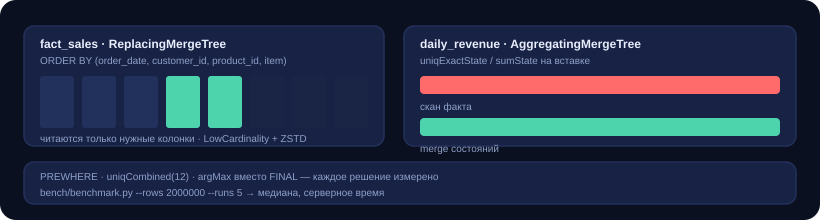

# 04 · ClickHouse: витрины и честный бенчмарк

Аналитический слой поверх того же факта продаж: колоночная модель, пред-агрегаты
на `AggregatingMergeTree`, и скрипт, который измеряет разницу между «так пишут в
туториалах» и «так работает на объёме» — вместо того чтобы пересказывать мифы.

<p align="center">
  
</p>

## Модель

| Объект | Движок | Зачем так |
| --- | --- | --- |
| `marts.fact_sales` | `ReplacingMergeTree(_loaded_at)` | повторная загрузка строки не удваивает выручку: дедуп по ключу `ORDER BY` |
| `marts.daily_revenue` | `AggregatingMergeTree` + MV | дневная выручка считается на вставке, чтение мержит состояния |
| `marts.customer_lifetime` | `ReplacingMergeTree` | LTV-витрина, обновляется батчем |

Ключевые решения:

**`ORDER BY (order_date, customer_id, product_id, order_item_id)`.** Почти каждый
аналитический запрос фильтрует по дате, поэтому первая колонка ключа — дата:
sparse primary index отбрасывает гранулы до чтения колонок.

**`PARTITION BY toYYYYMM(order_date)`.** Партиция на месяц — золотая середина:
`DROP PARTITION` для ретеншена, но не тысячи мелких партиций (это убивает merges).

**`LowCardinality(String)` на категориях и статусах.** Словарное кодирование
превращает повторяющиеся строки в небольшие целые — основной выигрыш по сжатию
для таких колонок.

**`AggregateFunction(uniqExact, String)` в марте.** Состояние вместо значения:
`...State` на вставке, `...Merge` на чтении. Одна и та же цифра, но считается
один раз, а не на каждый дашборд.

**`Decimal(18,2)` для денег, `UInt32` для количества.** Никаких `Float64` в
выручке: `0.1 + 0.2` в бинарной плавающей точке — это тикет от финансов.

## Бенчмарк

`bench/benchmark.py` сравнивает пары запросов, отличающиеся ровно одним решением:

| Кейс | Медленно | Быстро |
| --- | --- | --- |
| Расположение фильтра | `WHERE order_date` | `PREWHERE order_date` |
| Уникальные клиенты | `uniqExact` | `uniqCombined(12)` |
| Выручка по дням | скан факта | `AggregatingMergeTree`-март |
| Дедупликация | `FINAL` | `GROUP BY` + `argMax` |

```bash
# наполнить синтетикой и померить
python 04-clickhouse-marts/bench/benchmark.py --rows 2000000 --runs 5
```

Скрипт берёт медиану нескольких прогонов (первый прогон платит за чтение колонок
с диска и льстит тому, что запущено вторым) и печатает таблицу с ускорением.
Числа в README не приводятся намеренно: они зависят от железа и объёма, поэтому
их надо получить у себя, а не переписать из чужого поста.

## Что показывает `FINAL` vs `argMax`

`ReplacingMergeTree` дедуплицирует **в момент слияния**, не в момент чтения.
Поэтому `SELECT ... FINAL` даёт гарантированно актуальную строку, но платит
дедупликацией на каждом запросе. Альтернатива — агрегировать самому:
`argMax(net_amount, _loaded_at)`. Для дашборда это правильный компромисс, для
сверки с бухгалтерией — нет. Выбор должен быть осознанным, а не «мы всегда
пишем FINAL».

## Запуск

```bash
# DDL
docker compose exec clickhouse clickhouse-client --multiquery < 04-clickhouse-marts/sql/01_schema.sql

# готовые запросы (витрина, PREWHERE, приблизительный distinct, LTV)
docker compose exec -T clickhouse clickhouse-client --multiquery < 04-clickhouse-marts/sql/02_marts.sql
```
