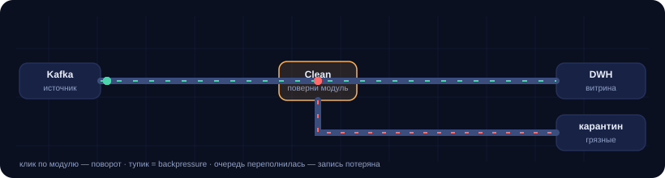

# 06 · Игра «Труба пайплайна»

Сеточная головоломка: собери трубу от источника до витрины и уведи грязные
записи в карантин. Каждый клик по модулю — поворот на 90°. Пока труба дырявая,
записи копятся в тупике и теряются — это и есть backpressure.

<p align="center">
  
</p>

## Правила

- Сетка 10×6. `Kafka` слева выпускает записи, `DWH` справа принимает чистые,
  `карантин` снизу — грязные.
- `Clean` (жёлтый модуль) — маршрутизатор: **чистую** запись пропускает прямо,
  **грязную** уводит вбок (вправо от направления движения).
- Клик по модулю — поворот. Источник, витрина и карантин не вращаются.
- Тупик не убивает запись сразу: она стоит в трубе 2.5 секунды, потом считается
  потерянной. Чем больше дыр в трубе, тем быстрее кончается лимит потерь.
- Грязная запись, дошедшая до `DWH`, — протечка: качество падает, лимит
  `maxLeaked` закрывает уровень.

## Уровни

| Уровень | Что проверяет | Цель |
| --- | --- | --- |
| 1 · Первый поток | базовый маршрут и разветвление в карантин | 12 доставлено, ≤2 потерь, ≤1 протечки |
| 2 · Глубже в хранилище | длиннее путь грязных, больше брака (30%) | 14 доставлено, ≤3 потерь |
| 3 · Долгий путь в карантин | два поворота вниз, 35% брака | 15 доставлено, ≤3 потерь |

Победа — когда все записи разобраны и цели по доставке, потерям и протечкам
выполнены. Управление: `пробел` — старт/пауза, `R` — заново, `1..3` — уровень.

## Почему это про данные, а не про трубы

- **Топология важнее скорости.** Пока не соединён путь, никакая скорость не
  поможет: запись просто не дойдёт.
- **Разветвление — это Data Quality.** `Clean` — единственное место, где
  грязная запись может уйти в карантин; забыл повернуть — она протечёт в DWH.
- **Backpressure видно глазами.** Тупик не «теряет» запись мгновенно: она стоит,
  копится, и только потом падает в потери. Ровно то, что в жизни лечат ёмкостью,
  а не ретраями.

## Как это проверено

Игра — чистый JavaScript, поэтому уровни валидируются на уровне модели:
`tests/test_levels.py` разбирает JSON уровней из страницы и доказывает, что

1. каждый уровень **решаем**: существует набор поворотов, при котором чистые
   доходят до `DWH`, а грязные — через `Clean` до карантина;
2. уровень **не решён сразу**: в стартовой конфигурации маршрут не складывается,
   иначе кликать было бы нечего;
3. геометрия, набор символов, цели и повороты согласованы.

Модель повторяет движок: маски сторон, поворот на 90°, соединение «оба конца
смотрят друг на друга» и правило маршрутизации `Clean`.

```bash
python -m pytest tests/test_levels.py -q     # 34 теста
```

## Файлы

- `index.html` — игра целиком: JSON уровней + движок (canvas, фиксированный шаг
  1/60 с, без зависимостей).
- `tests/test_levels.py` — валидатор уровней.
