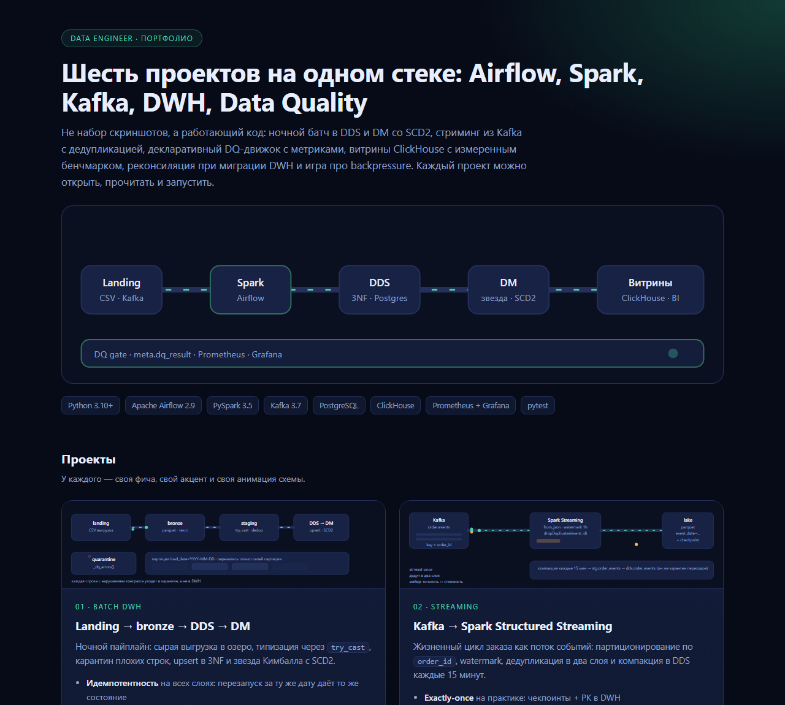
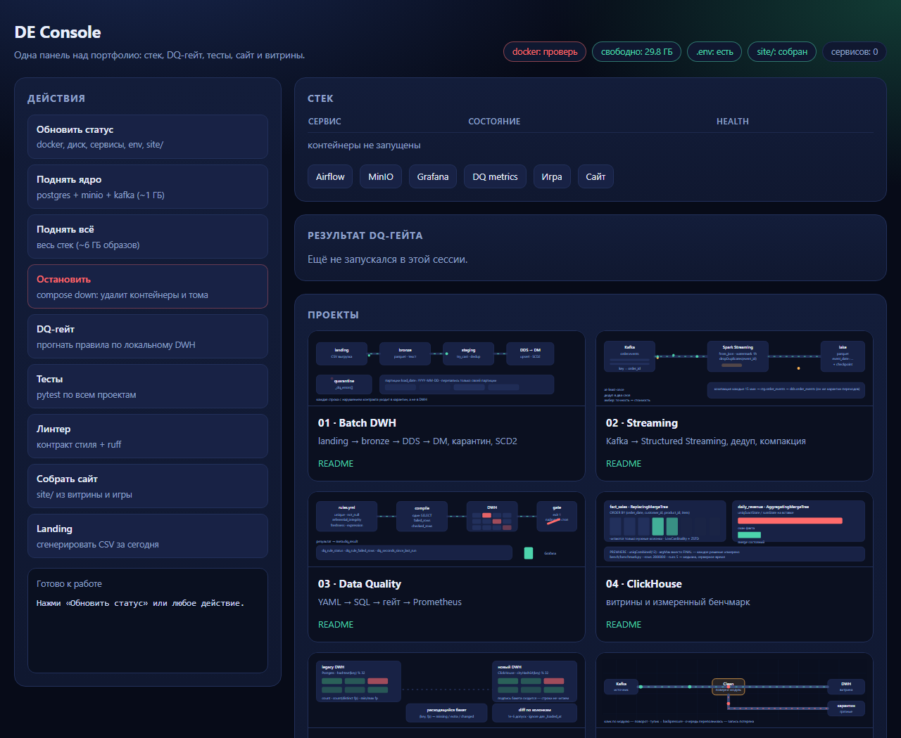
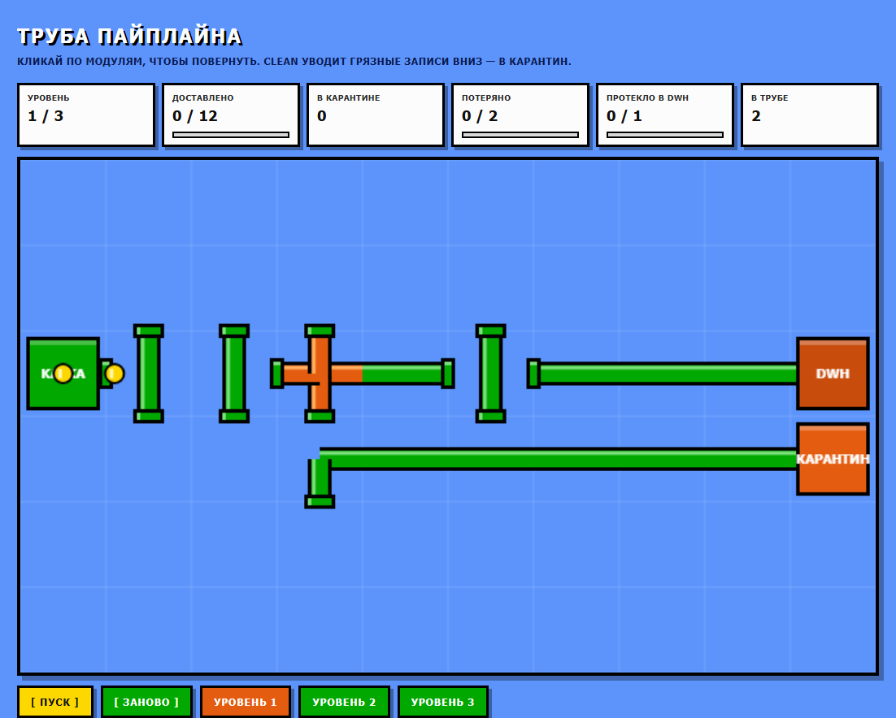

# Data Engineer · портфолио: 6 проектов на одном стеке

<p align="center">
  
</p>

Airflow, Spark, Kafka, DWH (3NF + Kimball), Data Quality, ClickHouse, миграция
хранилища — и игра про backpressure. Не набор слайдов: код запускается, тесты
проходят (`564 passed`), у каждого проекта есть анимированная схема и README с
объяснением решений, а не пересказом документации.

```bash
make doctor      # что установлено: docker, compose, make, cloudflared, место на диске
make up-core     # postgres + minio + kafka (~1 ГБ образов)
make up          # весь стек: + spark, airflow, clickhouse, prometheus, grafana (~6 ГБ)
make landing     # синтетический landing-слой: 800 заказов + справочники
make dq          # DQ-гейт по локальному DWH
make console     # визуальная панель: http://localhost:8088
make test        # 564 теста без Docker и без Spark
make site        # собрать site/ и отдать на http://localhost:8000
make tunnel      # cloudflared: публичный URL на этот порт
make showcase    # docs/index.html — витрина портфолио с анимациями
make game        # игра-головоломка «Труба пайплайна»
```

Установка Docker и бюджет диска — в [docs/docker-setup.md](docs/docker-setup.md)
(там же честный статус проверок и почему `make tunnel` не сработал на этой сети).

## Визуальная панель

`make console` поднимает локальный пульт на `http://localhost:8088` — одна
страница, которая видит состояние стека и запускает всё остальное кнопками:

| Кнопка | Что делает |
| --- | --- |
| Обновить статус | `scripts/doctor.py`, `docker compose ps`, свободный диск, наличие `.env` и `site/` |
| Поднять ядро / всё / остановить | `compose up` для postgres+minio+kafka или всего стека, `compose down` |
| DQ-гейт | прогон правил по локальному DWH и разбор JSON-отчёта (passed/warned/failed) |
| Тесты | `pytest` с подсчётом исходов |
| Линтер | контракт стиля + ruff |
| Собрать сайт / Landing | `site/` из витрины и игры, генерация CSV |

Устройство: `console/actions.py` — реестр whitelisted-обработчиков и парсеры
выводов (всё в Python, поэтому тестируется), `console/server.py` — HTTP на stdlib
с тремя статическими маршрутами, `console/index.html` — интерфейс. Пользовательский
ввод команды не формирует: фронтенд может попросить только имя из реестра,
неизвестное имя получает отказ. Тестов на панель — 26, включая обход попытки
path traversal.

## Проекты

| # | Проект | Фича, ради которой он существует | Анимация |
| --- | --- | --- | --- |
| 01 | [Батч-DWH](01-batch-dwh/README.md) | Идемпотентный батч landing → bronze → DDS → DM: карантин плохих строк, upsert в 3NF, звезда Кимбалла с SCD2 |  |
| 02 | [Стриминг](02-streaming-kafka/README.md) | Kafka → Structured Streaming: key=order_id, watermark, дедупликация в два слоя, валидация переходов в DWH |  |
| 03 | [Data Quality](03-dq-framework/README.md) | Свой DQ-движок: YAML → один `SELECT` с двумя счётчиками → `meta.dq_result` → Prometheus → Grafana |  |
| 04 | [ClickHouse](04-clickhouse-marts/README.md) | Колоночные витрины + бенчмарк, который мерит PREWHERE, `uniqCombined`, марты и цену `FINAL` |  |
| 05 | [Миграция DWH](05-migration-parity/README.md) | Реконсиляция старого и нового хранилища по подписям бакетов, diff по ключам и колонкам, cutover-гейт по exit-коду |  |
| 06 | [Игра](06-pipeline-game/README.md) | «Труба пайплайна»: поворачивай модули, уводи грязные в карантин, тупик = backpressure |  |

Каждая схема — самодостаточный SVG с CSS-анимацией: работает в GitHub, в
`docs/index.html` и просто в браузере, без GIF и внешних зависимостей.

## Что здесь важнее кода

Три вещи, которые отличают продакшн-пайплайн от учебного, и все три есть в репозитории:

1. **Идемпотентность.** Любой шаг можно перезапустить: bronze перезаписывает свою
   партицию, staging заменяется целиком, DDS делает upsert по бизнес-ключу, факт
   пересобирается по скользящему окну. Ответ на «а если ночной прогон упал на 80%?»
   находится в коде, а не в голове автора.
2. **Плохие данные не текут дальше.** Контракт нарушен → строка в карантине с
   метками, а не упавшая джоба и не тихо испорченная витрина. Дальше DQ-гейт
   закрывает пайплайн по правилам severity.
3. **Наблюдаемость.** Каждый прогон оставляет след: `meta.pipeline_run` со
   счётчиками строк, `meta.dq_result` с вердиктами по правилам, метрики в
   Prometheus, дашборд в Grafana. Алерт на «свежесть» ловит сломанный шедулер,
   алерт на «долю карантина» — поломку контракта источника.

## Стиль кода: контракт, который проверяет линтер

В репозитории действует жёсткое правило читаемости, и оно не «на совести
ревьюера», а проверяется на каждом прогоне:

| Правило | Почему |
| --- | --- |
| Никаких `continue` | шаг цикла — это второй, неявный выход из функции |
| Никакого `break` | выход из середины функции, который легко пропустить |
| Никакого `while True` | единственный выход из него — `break`/`return`, то есть тот же второй выход |
| Один `return` на функцию, и он последний оператор | читаешь сверху вниз и не ищешь, где функция «на самом деле» кончается |
| Вложенность операторов ≤ 2 | `for` + `if` — можно, `for` + `if` + `if` — уже нет, выноси в функцию |

Контракт зашит в два места:

- `scripts/check_style.py` — AST-чекер (`DE001`…`DE005`). `elif` не считается
  вложенностью: в AST это вложенный `if`, семантически — тот же уровень. Чекер
  проходит собственный контракт, иначе его бы никто не принял всерьёз.
- `pyproject.toml` — ruff с `max-returns = 1` (`PLR0911`) плюс `E/F/W/I/UP/B/C4/SIM/RET/PIE`.

```bash
make lint     # check_style.py + ruff
make test     # 564 теста, включая tests/test_style_contract.py
```

`tests/test_style_contract.py` делает две вещи: проверяет, что чекер **ловит**
каждое нарушение (сломанный линтер не должен молча проходить), и прогоняет его
по всему репозиторию — так регрессия падает в `make test`, а не на ревью.

## Структура

```
.
├── 01-batch-dwh/          SQL-слои (schema, merge, DM), Spark-джобы, README
├── 02-streaming-kafka/    модель событий, продюсер, стрим-джоба, компакция, tests
├── 03-dq-framework/       движок правил, CLI, экспортёр метрик, Grafana-дашборд, tests
├── 04-clickhouse-marts/   DDL витрин, аналитические запросы, бенчмарк
├── 05-migration-parity/   реконсиляция, адаптеры, чек-лист cutover, tests
├── 06-pipeline-game/      игра: сетка модулей, повороты, карантин (один HTML-файл)
├── dags/                  Airflow DAGs: orders_batch_dwh, order_events_compaction
├── ingestion/             генератор landing-слоя + загрузка в MinIO
├── console/               визуальная панель: actions.py, server.py, index.html
├── docs/                  index.html (витрина), assets/*.svg (анимации), screens/ (скриншоты), talking-points
├── scripts/               init_db.sh, run_stream.sh, warm_jars.py
├── docker/airflow/        образ с Java + pyspark для spark-submit из Airflow
└── docker-compose.yml     весь стек
```

Команды: `make help`.

## Стек

Python 3.10+ · Apache Airflow 2.9 · PySpark 3.5 · Kafka 3.7 (KRaft) · PostgreSQL 16 ·
ClickHouse 24.3 · MinIO (S3) · Prometheus + Grafana · pytest · ruff

## Проверено и не проверено

Честно, потому что иначе это не портфолио, а буклет:

- **Проверено локально:** `pytest` — 564 теста (контракт событий, компилятор DQ-правил,
  экспортёр метрик, движок реконсиляции, генератор landing-слоя); генератор
  данных отработал и создал 5 CSV с ~3% дефектов; все 7 SVG — валидный XML.
- **Проверено на реальном Docker:** Docker Desktop 29.9.2 + Compose v5.6.1,
  `docker compose config` проходит, `make up-core` поднимает postgres/minio/kafka,
  Postgres создаёт схемы `stg/dds/dm/meta` и 6 таблиц DDS, `minio-init` создаёт
  бакет, `make dq` отрабатывает по живой базе (11 passed, 2 failed на пустой
  витрине — ожидаемо). Подробности: [docs/docker-setup.md](docs/docker-setup.md).
- **Не проверено в этой среде:** полный `make up` (нужно ~6 ГБ образов, свободно
  было 3.1 ГБ), реальные прогоны Spark-джоб и DAG'ов, цифры бенчмарка ClickHouse.
- **Туннель сайта:** `make site` отдаёт страницу и игру локально (200 на `/`,
  `/game/index.html`, `/assets/*`), а cloudflared quick tunnel на этой сети не
  создаётся — `POST https://api.trycloudflare.com/tunnel` уходит в таймаут.
  `make tunnel` оставлен рабочим для сетей, где quick tunnel разрешён.
- **Бенчмарк без зашитых результатов.** `04-clickhouse-marts` намеренно не
  содержит красивых чисел: их надо получить самому, `make bench`.

## Скриншоты

Снято с того, что лежит в репозитории, без ретуши.

<p align="center">
  
</p>

<table>
  <tr>
    <td></td>
    <td></td>
  </tr>
</table>

**Игра на GitHub Pages:** <https://kepanasyuke.github.io/de-portfolio/game/> —
то же, что `make game`, но по ссылке, без клонирования.
Витрина там же: <https://kepanasyuke.github.io/de-portfolio/>.

Страницы собирает `.github/workflows/pages.yml`: `python scripts/build_site.py --out site`,
дальше артефакт уходит в Pages. В настройках репозитория достаточно один раз выбрать
Settings → Pages → Source: **GitHub Actions** — после первого пуша в `main` ссылки выше оживут.
