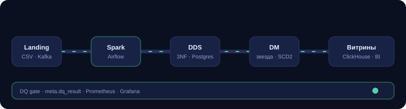
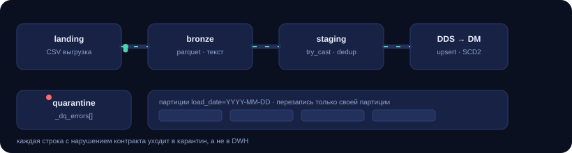
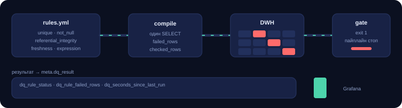
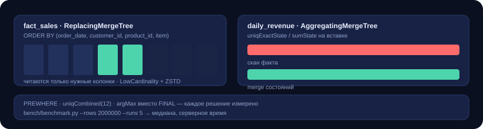
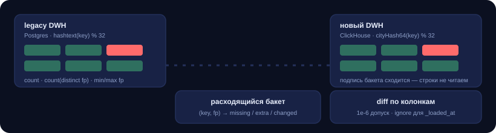
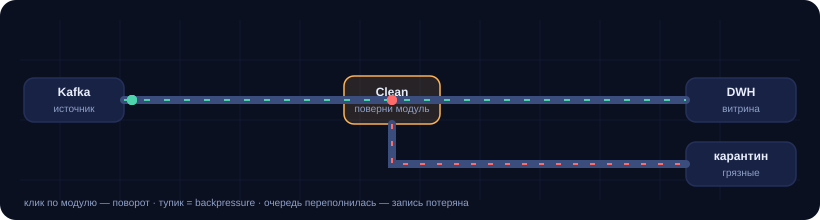

# Data Engineer · портфолио: 6 проектов на одном стеке

<p align="center">
  
</p>

Airflow, Spark, Kafka, DWH (3NF + Kimball), Data Quality, ClickHouse, миграция
хранилища — и игра про backpressure. Не набор слайдов: код запускается, тесты
проходят (`60 passed`), у каждого проекта есть анимированная схема и README с
объяснением решений, а не пересказом документации.

```bash
cp .env.example .env
make up          # postgres, kafka, minio, spark, airflow, clickhouse, prometheus, grafana
make landing     # синтетический landing-слой: 800 заказов + справочники
make test        # 60 тестов без Docker и без Spark
make showcase    # docs/index.html — витрина портфолио с анимациями
make game        # игра «Пайплайн: ночной релиз»
```

## Проекты

| # | Проект | Фича, ради которой он существует | Анимация |
| --- | --- | --- | --- |
| 01 | [Батч-DWH](01-batch-dwh/README.md) | Идемпотентный батч landing → bronze → DDS → DM: карантин плохих строк, upsert в 3NF, звезда Кимбалла с SCD2 |  |
| 02 | [Стриминг](02-streaming-kafka/README.md) | Kafka → Structured Streaming: key=order_id, watermark, дедупликация в два слоя, валидация переходов в DWH |  |
| 03 | [Data Quality](03-dq-framework/README.md) | Свой DQ-движок: YAML → один `SELECT` с двумя счётчиками → `meta.dq_result` → Prometheus → Grafana |  |
| 04 | [ClickHouse](04-clickhouse-marts/README.md) | Колоночные витрины + бенчмарк, который мерит PREWHERE, `uniqCombined`, марты и цену `FINAL` |  |
| 05 | [Миграция DWH](05-migration-parity/README.md) | Реконсиляция старого и нового хранилища по подписям бакетов, diff по ключам и колонкам, cutover-гейт по exit-коду |  |
| 06 | [Игра](06-pipeline-game/README.md) | «Пайплайн: ночной релиз»: три пайплайна, очередь, backpressure, SLO и качество данных |  |

Каждая схема — самодостаточный SVG с CSS-анимацией: работает в GitHub, в
`docs/index.html` и просто в браузере, без GIF и внешних зависимостей.

## Что здесь важнее кода

Три вещи, которые отличают продакшн-пайплайн от учебного, и все три есть в репозитории:

1. **Идемпотентность.** Любой шаг можно перезапустить: bronze перезаписывает свою
   партицию, staging заменяется целиком, DDS делает upsert по бизнес-ключу, факт
   пересобирается по скользящему окну. Ответ на «а если ночной прогон упал на 80%?»
   находится в коде, а не в голове автора.
2. **Плохие данные не текут дальше.** Контракт нарушен → строка в карантине с
   метками, а не упавшая джоба и не тихо испорченная витрина. Дальше DQ-гейт
   закрывает пайплайн по правилам severity.
3. **Наблюдаемость.** Каждый прогон оставляет след: `meta.pipeline_run` со
   счётчиками строк, `meta.dq_result` с вердиктами по правилам, метрики в
   Prometheus, дашборд в Grafana. Алерт на «свежесть» ловит сломанный шедулер,
   алерт на «долю карантина» — поломку контракта источника.

## Структура

```
.
├── 01-batch-dwh/          SQL-слои (schema, merge, DM), Spark-джобы, README
├── 02-streaming-kafka/    модель событий, продюсер, стрим-джоба, компакция, tests
├── 03-dq-framework/       движок правил, CLI, экспортёр метрик, Grafana-дашборд, tests
├── 04-clickhouse-marts/   DDL витрин, аналитические запросы, бенчмарк
├── 05-migration-parity/   реконсиляция, адаптеры, чек-лист cutover, tests
├── 06-pipeline-game/      игра (один HTML-файл)
├── dags/                  Airflow DAGs: orders_batch_dwh, order_events_compaction
├── ingestion/             генератор landing-слоя + загрузка в MinIO
├── docs/                  index.html (витрина), assets/*.svg (анимации), talking-points
├── scripts/               init_db.sh, run_stream.sh, warm_jars.py
├── docker/airflow/        образ с Java + pyspark для spark-submit из Airflow
└── docker-compose.yml     весь стек
```

Команды: `make help`.

## Стек

Python 3.10+ · Apache Airflow 2.9 · PySpark 3.5 · Kafka 3.7 (KRaft) · PostgreSQL 16 ·
ClickHouse 24.3 · MinIO (S3) · Prometheus + Grafana · pytest · ruff

## Проверено и не проверено

Честно, потому что иначе это не портфолио, а буклет:

- **Проверено локально:** `pytest` — 60 тестов (контракт событий, компилятор DQ-правил,
  экспортёр метрик, движок реконсиляции, генератор landing-слоя); генератор
  данных отработал и создал 5 CSV с ~3% дефектов; все 7 SVG — валидный XML.
- **Не проверено в этой среде:** `docker compose up` (Docker недоступен), реальные
  прогоны Spark-джоб и DAG'ов, цифры бенчмарка ClickHouse. Конфигурация написана
  по документации образов, но первый запуск стека — это первый запуск.
- **Бенчмарк без зашитых результатов.** `04-clickhouse-marts` намеренно не
  содержит красивых чисел: их надо получить самому, `make bench`.

## Дальше

- `docs/talking-points.md` — как рассказывать эти проекты на интервью: какой
  вопрос к какому файлу, где сознательный компромисс, о чём не врать.
- `docs/index.html` — то же самое визуально, если нужно показать за 2 минуты.
